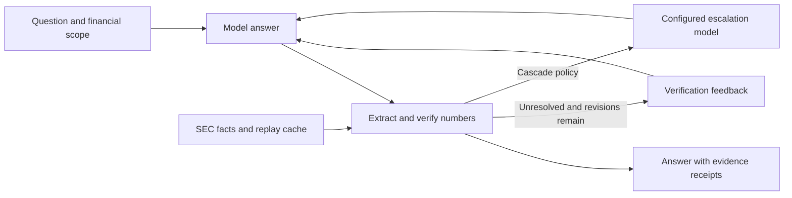

# FinReceipts

**Financial AI content with evidence, iterative revision and traceable delivery.**

[中文](README.zh-CN.md) · [Architecture](docs/ARCHITECTURE.md) · [Validation](docs/reproducibility.md) · [CI](https://github.com/Sinfony8838/FinReceipts/actions/workflows/ci.yml) · [Apache-2.0](LICENSE)

A plausible financial number can still belong to the wrong company, metric or period.
FinReceipts connects model generation to factual checks, bounded revision and evidence
delivery, so users can inspect sources, review changes and compare feedback strategies.

The scope is financial research: supported numeric claims are checked against SEC XBRL
facts. A browser workbench, HTML receipts and JSON exports make results inspectable.

## Workflow and delivery

1. **Generate a draft:** specify the company, fiscal years and research question.
2. **Check and revise:** verify numeric evidence, then provide error flags or retrieved facts.
3. **Review and deliver:** inspect attempts, receipts and execution records for human review.

[Workflow case study and design choices](docs/AI_WORKFLOW_CASE.md) (Chinese)

## See the workflow

The offline Apple demo starts with a deliberately incorrect answer and follows the same
answer → verify → revise path used by the application:

| Step | Answer / evidence | Outcome |
|---|---|---|
| First answer | FY2023 revenue: **$390.0 billion** | No matching fact |
| Revision | FY2023 revenue: **$383.3 billion** | Matches within configured tolerance |
| Receipt | **$383,285,000,000**, period ending **2023-09-30**, selected SEC revenue concept | Inspect the fact and filing |

No API key is needed. Both answers are scripted by the fake provider: this demonstrates
the workflow, not a model accuracy result. A numeric match does not establish that every
surrounding statement has the right issuer, metric or period.
## Controlled comparison

Compare direct generation, error-flag revision and evidence-fed revision using final numeric
answer matching, unsupported numbers, model calls, latency and token usage. Functional tests,
scripted demonstrations and live-model results are reported separately.

On 2026-10-16, MiniMax-M3 was evaluated on 30 questions generated from recorded AAPL/NVDA SEC data:

| Strategy | Final numeric answers matched | Model calls |
|---|---:|---:|
| Direct generation | 21/30 | 30 |
| Error-flag revision | 17/30 | 63 |
| Evidence-fed revision | 30/30 | 68 |

This is one run on two companies. Evidence-fed revision supplies retrieved values; these
results do not establish whole-answer correctness, model fine-tuning gains or marketing impact.

[Current experiment, results and limits](docs/WORKFLOW_EVALUATION.md) · [Historical provenance](docs/EVALUATION_NOTES.md)

## Engineering highlights

[Review three reproducible failure cases](docs/ENGINEERING_CASES.md): database contention after
a model response, workers that outlive HTTP requests, and backups that miss committed WAL data.

| Capability | Design choice | Source |
|---|---|---|
| Verification-driven orchestration | LangGraph routes between answer, verify, bounded revision and optional model escalation | [Workflow](src/finreceipts/agent/graph.py) |
| Deterministic financial checks | Explicit number extraction, units, tolerances and XBRL metric calculations | [Verifier](src/finreceipts/verify/) · [Metrics](src/finreceipts/xbrl/) |
| Controlled feedback experiments | Separate error flags from receipts that also supply retrieved values | [Evaluation controls](docs/eval-controls.md) |
| Inspectable results | Per-attempt audits, HTML receipts and step-level SSE events | [API](src/finreceipts/app/main.py) · [Reports](src/finreceipts/report/) |
| Bounded execution and troubleshooting | Process-local admission, cancellation-aware worker accounting, safe request diagnostics and reproducible fault tests | [Admission](docs/ADMISSION_CONTROL.md) · [Diagnostics](docs/REQUEST_DIAGNOSTICS.md) · [Reliability](docs/RELIABILITY.md) |
| Backup and recovery | Online SQLite snapshots, verified event chains and budgets, restore to new directories, offline failure drills | [Restore runbook](docs/BACKUP_RESTORE.md) |
| Container data retention | Separate runtime volume and a recreation gate; existing writable-layer databases require migration | [Storage and verification status](docs/CONTAINER_STORAGE.md) |
| Repeatable local development | SEC record/replay cache, offline fixtures and a fake model provider | [Data clients](src/finreceipts/tools/) · [Tests](tests/) |
| Explicit evidence boundaries | Timestamp/catalog controls and synthetic injection-boundary checks | [PIT contracts](docs/pit-redteam.md) |

Python · LangGraph · FastAPI · Pydantic · SSE · SEC XBRL · pytest
## Durable evidence workbench

Version 0.1.0 adds **frozen-evidence runs** alongside the request-scoped demo.
This preview release is intended for local research and reproducible demonstrations.


- **Recover at committed node boundaries:** JSON checkpoints and SQLite transactions keep state and events together.
- **Bound execution before dispatch:** persisted model/tool reservations survive interruption and explicit recovery.
- **Fence competing results:** revision checks and lease tokens reject stale advances and late worker commits.
- **Reconnect without rerunning:** sequenced events support cursor-based catch-up; exports carry evidence and integrity checks.
- **Compare verification conditions:** replay numeric matching and bounded annual-clause checks on the same evidence without another model call.
- **Inspect the result:** Chinese workbench, light/dark/system themes, responsive layout and expandable raw records.

Recovery cannot guarantee exactly-once external calls. Dispatch budgets are not billing caps;
evidence hashes are not independent historical-availability proofs.

[Runtime contract](docs/RUNTIME.md) · [Fault tests and validation](docs/VALIDATION.md) ·
[UI walkthrough and screenshots](docs/UI_REDESIGN.md) · [Engineering record](docs/ENGINEERING_LOG.md)
## How it works



The verifier supplies both the evidence a reader can inspect and the signal that controls
revision. The model does not grade its own answer. The scope remains the numeric claims
the extractor and available evidence can support. [Read the design decisions →](docs/ARCHITECTURE.md)
## Run locally

Use Python 3.11+ and a source checkout. The bundled offline facts cover AAPL and NVDA.

```sh
git clone https://github.com/Sinfony8838/FinReceipts.git
cd FinReceipts
python -m venv .venv
```

Activate the environment before installing dependencies: `source .venv/bin/activate` on Linux/macOS,
or `.venv\Scripts\Activate.ps1` in PowerShell. Alternatively use the environment's Python directly.

<details>
<summary>Linux / macOS</summary>

```sh
. .venv/bin/activate
python -m pip install -e ".[dev,web]"
FINRECEIPTS_HOST=127.0.0.1 FINRECEIPTS_LLM_PROVIDER=fake \
  FINRECEIPTS_OFFLINE=1 FINRECEIPTS_CACHE_DIR=tests/fixtures/sec finreceipts-api
```

</details>

<details>
<summary>Windows PowerShell</summary>

```powershell
.venv\Scripts\Activate.ps1
python -m pip install -e ".[dev,web]"
$env:FINRECEIPTS_HOST = "127.0.0.1"
$env:FINRECEIPTS_LLM_PROVIDER = "fake"
$env:FINRECEIPTS_OFFLINE = "1"
$env:FINRECEIPTS_CACHE_DIR = "tests/fixtures/sec"
finreceipts-api
```

</details>

Open **http://127.0.0.1:8000/workbench**. Click **创建任务**, **推进一步**,
then refresh: the committed answer remains and the next step is verification.
Click **继续执行** followed by **复核当前回答** to compare numeric matching with bounded
annual-clause checks. The **快速问答** page retains request-scoped streaming and one-shot responses.

Installation may need network access. Demo fixtures and example reports are supplied by
the checkout, not a standalone wheel. To use a live provider, see [LLM configuration](docs/llm_access.md).
## Verify the behavior

```sh
python -m pytest -m "not live" -q
python -m ruff check .
```

Tests cover extraction, financial metrics, revision/routing, API/SSE responses, evidence
serialization and evaluation controls. Functional tests and fake-model demonstrations
are separate from live-provider quality measurements.
See the [environment and validation record](docs/reproducibility.md).
For cache publication failures, process races and storage contention recovery,
see the [reliability scenarios and runbook](docs/RELIABILITY.md) (Chinese).
## Interfaces

| Interface | Purpose |
|---|---|
| `POST /api/runs` | Create an idempotent durable run |
| `/api/runs/{id}/advance, resume, events, export` | Step execution, recovery and evidence inspection |
| `POST /api/ask` | Answer, audit and report in one response |
| `POST /api/ask/stream` | Step events followed by the final report |
| `POST /api/audit` | Audit supplied text against financial facts |
| `GET /health` | Inspect active provider and offline configuration |
| `finreceipts audit / eval / record` | Local auditing, evaluation and evidence capture |
## Scope and evaluation

FinReceipts is local research software. It does not provide production authentication,
validate all financial prose, or prove historical public availability from filing dates.
Keep the demo on loopback. Synthetic security tests do not establish real-model injection resistance.
Exact Host validation and browser-origin checks protect the local API from explicitly cross-origin
browser requests; they are not authentication. See [browser boundary and tests](docs/BROWSER_BOUNDARY.md).

### Historical experiment provenance

Earlier provider experiments are retained as [historical evaluation notes](docs/EVALUATION_NOTES.md),
not headline performance claims. Retrieved-value feedback, flags-only correction, denominators
and cost assumptions are documented separately; omitted result bundles are not current-release evidence.
## Data, license and related work

Three attributed SEC JSON fixtures are included. A-share adapters use synthetic offline
inputs; original Eastmoney/cninfo snapshots and their generated dataset are excluded.
See [data sources](docs/data_sources.md), [third-party notices](THIRD_PARTY_NOTICES.md)
and [disclaimer](DISCLAIMER.md).

Code is licensed under [Apache-2.0](LICENSE); upstream data and dependencies retain their own terms.
The project builds on established numeric-grounding and citation-verification ideas,
including FinDVer, ALCE, Self-RAG and FActScore. Its focus is integrating deterministic
financial checks into the agent's control flow and review interface.
