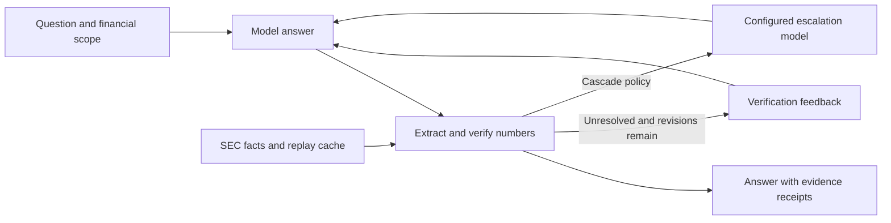

# FinReceipts

**Financial research agents with verifiable numbers and inspectable evidence.**

[中文](README.zh-CN.md) · [Architecture](docs/ARCHITECTURE.md) · [Validation](docs/reproducibility.md) · [CI](https://github.com/Sinfony8838/FinReceipts/actions/workflows/ci.yml) · [Apache-2.0](LICENSE)

FinReceipts connects financial question answering to a deterministic verification loop.
It extracts supported numeric claims, matches them against SEC XBRL facts, and uses the
audit to revise an answer or route unresolved work to another configured model.
Each matched number gets an HTML receipt showing the selected fact, period and source.

The core idea is to make verification part of **execution**, not just a citation added after generation.

## See the workflow

The offline Apple demo starts with a deliberately incorrect answer and follows the same
answer → verify → revise path used by the application:

| Step | Answer / evidence | Outcome |
|---|---|---|
| First answer | FY2023 revenue: **$390.0 billion** | No matching fact |
| Revision | FY2023 revenue: **$383.3 billion** | Matches within configured tolerance |
| Receipt | **$383,285,000,000**, period ending **2023-09-30**, selected SEC revenue concept | Inspect the fact and filing |

No API key is needed. Both answers are scripted by the fake provider: this demonstrates
the workflow, not a model accuracy result. A numeric match does not establish that every
surrounding statement has the right issuer, metric or period.

## Engineering highlights

| Capability | Design choice | Source |
|---|---|---|
| Verification-driven orchestration | LangGraph routes between answer, verify, bounded revision and optional model escalation | [Workflow](src/finreceipts/agent/graph.py) |
| Deterministic financial checks | Explicit number extraction, units, tolerances and XBRL metric calculations | [Verifier](src/finreceipts/verify/) · [Metrics](src/finreceipts/xbrl/) |
| Controlled feedback experiments | Separate error flags from receipts that also supply retrieved values | [Evaluation controls](docs/eval-controls.md) |
| Inspectable results | Per-attempt audits, HTML receipts and step-level SSE events | [API](src/finreceipts/app/main.py) · [Reports](src/finreceipts/report/) |
| Repeatable local development | SEC record/replay cache, offline fixtures and a fake model provider | [Data clients](src/finreceipts/tools/) · [Tests](tests/) |
| Explicit evidence boundaries | Timestamp/catalog controls and synthetic injection-boundary checks | [PIT contracts](docs/pit-redteam.md) |

Python · LangGraph · FastAPI · Pydantic · SSE · SEC XBRL · pytest

## How it works



The verifier supplies both the evidence a reader can inspect and the signal that controls
revision. The model does not grade its own answer. The scope remains the numeric claims
the extractor and available evidence can support. [Read the design decisions →](docs/ARCHITECTURE.md)

## Run locally

Use Python 3.11+ and a source checkout. The bundled offline facts cover AAPL and NVDA.

```sh
git clone https://github.com/Sinfony8838/FinReceipts.git
cd FinReceipts
python -m venv .venv
```

Activate the environment before installing dependencies: `source .venv/bin/activate` on Linux/macOS,
or `.venv\Scripts\Activate.ps1` in PowerShell. Alternatively use the environment's Python directly.

<details>
<summary>Linux / macOS</summary>

```sh
. .venv/bin/activate
python -m pip install -e ".[dev,web]"
FINRECEIPTS_HOST=127.0.0.1 FINRECEIPTS_LLM_PROVIDER=fake \
  FINRECEIPTS_OFFLINE=1 FINRECEIPTS_CACHE_DIR=tests/fixtures/sec finreceipts-api
```

</details>

<details>
<summary>Windows PowerShell</summary>

```powershell
.venv\Scripts\Activate.ps1
python -m pip install -e ".[dev,web]"
$env:FINRECEIPTS_HOST = "127.0.0.1"
$env:FINRECEIPTS_LLM_PROVIDER = "fake"
$env:FINRECEIPTS_OFFLINE = "1"
$env:FINRECEIPTS_CACHE_DIR = "tests/fixtures/sec"
finreceipts-api
```

</details>

Open **http://127.0.0.1:8000**. In the main-branch demo, select **AAPL FY2023**,
choose **verify** and **receipts**, then **Run with SSE**. Expect one revision and
the $383.3 billion receipt. The same number appears in the prose and the ANSWER line;
two matched mentions are not two independent facts.

Installation may need network access. Demo fixtures and example reports are supplied by
the checkout, not a standalone wheel. To use a live provider, see [LLM configuration](docs/llm_access.md).

## Verify the behavior

```sh
python -m pytest -m "not live" -q
python -m ruff check .
```

Tests cover extraction, financial metrics, revision/routing, API/SSE responses, evidence
serialization and evaluation controls. Functional tests and fake-model demonstrations
are separate from live-provider quality measurements.
See the [environment and validation record](docs/reproducibility.md).

## Interfaces

| Interface | Purpose |
|---|---|
| `POST /api/ask` | Answer, audit and report in one response |
| `POST /api/ask/stream` | Step events followed by the final report |
| `POST /api/audit` | Audit supplied text against financial facts |
| `GET /health` | Inspect active provider and offline configuration |
| `finreceipts audit / eval / record` | Local auditing, evaluation and evidence capture |

## Scope and evaluation

FinReceipts is local research software. It does not provide production authentication,
validate all financial prose, or prove historical public availability from filing dates.
Keep the demo on loopback. Synthetic security tests do not establish real-model injection resistance.

### Historical experiment provenance

Earlier provider experiments are retained as [historical evaluation notes](docs/EVALUATION_NOTES.md),
not headline performance claims. Retrieved-value feedback, flags-only correction, denominators
and cost assumptions are documented separately; omitted result bundles are not current-release evidence.

## Data, license and related work

Three attributed SEC JSON fixtures are included. A-share adapters use synthetic offline
inputs; original Eastmoney/cninfo snapshots and their generated dataset are excluded.
See [data sources](docs/data_sources.md), [third-party notices](THIRD_PARTY_NOTICES.md)
and [disclaimer](DISCLAIMER.md).

Code is licensed under [Apache-2.0](LICENSE); upstream data and dependencies retain their own terms.
The project builds on established numeric-grounding and citation-verification ideas,
including FinDVer, ALCE, Self-RAG and FActScore. Its focus is integrating deterministic
financial checks into the agent's control flow and review interface.
