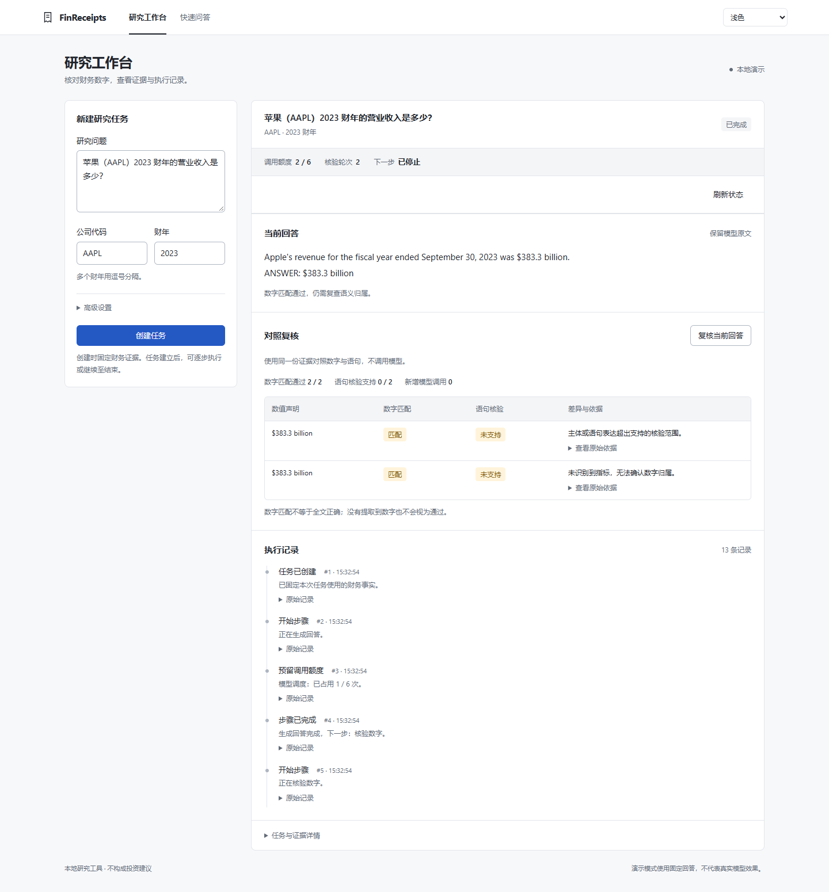
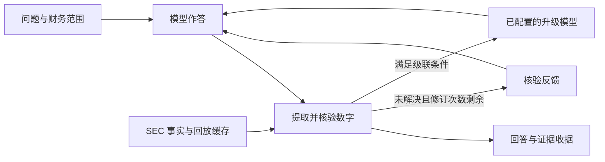

# FinReceipts

**让 AI 生成的财务内容有依据、可修订、可复查。**

[English](README.md) · [架构设计](docs/ARCHITECTURE.md) · [验证记录](docs/reproducibility.md) · [持续集成](https://github.com/Sinfony8838/FinReceipts/actions/workflows/ci.yml) · [Apache-2.0](LICENSE)

财务研究内容中的数字即使看起来合理，也可能对应错误的公司、指标或期间。
FinReceipts 将模型生成接入“事实核验 → 反馈修订 → 证据交付”流程，
帮助使用者检查回答依据、追踪修改过程，并比较不同反馈策略的结果和调用开销。

项目保留金融研究的明确场景：以 SEC XBRL 财务事实核验可提取的数值，
通过浏览器工作台、HTML 证据收据和 JSON 导出交付可复查的结果。

## 工作流与交付

1. **生成初稿**：明确公司、财年和研究问题，由配置的模型作答。
2. **核验并修订**：检查数值依据；根据错误标记或检索事实反馈进行有限修订。
3. **复查并交付**：查看每轮回答、证据和执行记录，必要时继续人工核对。

[阅读工作流案例与方案取舍](docs/AI_WORKFLOW_CASE.md)

## 先看一次完整流程

无需密钥的 Apple 离线演示，从一条刻意写错的回答开始：

| 步骤 | 回答或证据 | 结果 |
|---|---|---|
| 首次回答 | 2023 财年营收 **3,900 亿美元**（$390.0 billion） | 未找到匹配事实 |
| 修订回答 | 2023 财年营收 **3,833 亿美元**（$383.3 billion） | 在配置容差内匹配 |
| 证据收据 | 原始值 **383,285,000,000 美元**，期间截至 **2023-09-30**，所选 SEC 营收指标 | 可继续核对事实与原始披露 |

两条回答均由 fake provider 预设，演示的是“作答 → 核验 → 修订”的完整流程，不是模型准确率。
数字匹配也不代表上下文中的公司、指标、期间和全部语句均已核实。
## 对照实验

比较直接生成、错误提示后修订、证据反馈后修订，记录数值答案匹配率、
无依据数字比例、调用次数、耗时和 token 用量。工程测试、固定回答演示与真实模型评测分别记录。

2026-10-16：MiniMax-M3 在 AAPL/NVDA 历史 SEC 快照生成的 30 题上，三种策略结果如下。

| 策略 | 最终数值匹配 | 模型调用 |
|---|---:|---:|
| 直接生成 | 21/30 | 30 |
| 错误提示修订 | 17/30 | 63 |
| 证据反馈修订 | 30/30 | 68 |

这是两家公司、单轮实验的数值答案结果；证据反馈提供了检索数值，不代表全文正确、模型微调或营销效果提升。

[查看本轮样本、结果与限制](docs/WORKFLOW_EVALUATION.md) · [历史实验来源](docs/EVALUATION_NOTES.md)

## 核心工程设计

| 能力 | 实现方式 | 代码与说明 |
|---|---|---|
| 核验驱动的 Agent 编排 | LangGraph 状态路由、有限修订、可选模型升级 | [工作流](src/finreceipts/agent/graph.py) |
| 确定性财务核验 | 显式数字提取、单位归一、容差和 XBRL 指标计算 | [核验器](src/finreceipts/verify/) · [指标](src/finreceipts/xbrl/) |
| 可区分的反馈实验 | 错误标记与附带检索数值的证据反馈分别评估 | [评测控制](docs/eval-controls.md) |
| 可检查的执行结果 | 每轮审计、HTML 收据、步骤级 SSE 事件 | [接口](src/finreceipts/app/main.py) · [报告](src/finreceipts/report/) |
| 可重复的本地开发 | SEC 录制/回放缓存、离线 fixtures、固定模型响应 | [数据客户端](src/finreceipts/tools/) · [测试](tests/) |
| 明确的证据使用条件 | 时间戳与 catalog 控制、合成注入边界检查 | [时点与边界约定](docs/pit-redteam.md) |

Python · LangGraph · FastAPI · Pydantic · SSE · SEC XBRL · pytest
## 可恢复的证据工作台

0.1.0 版本在单次问答之外增加了**固定证据的持久化任务**。
本次为预览发布，用于本地研究与可复现演示。



- **节点边界恢复**：JSON 检查点与 SQLite 事务一起提交状态和事件。
- **调用前预留额度**：模型与工具调用先占用预算，中断及恢复后不重置。
- **拒绝并发旧结果**：状态版本与租约令牌约束推进，拒绝迟到结果。
- **断线后补读**：事件序号与游标支持重连，刷新不重跑；导出保留证据和完整性校验。
- **同证据对照复核**：比较数字匹配与受支持年度语句核验，不增加模型调用。
- **结果可复查**：中文工作台、浅色/深色/跟随系统主题、响应式布局与可展开原始记录。

恢复不承诺外部调用恰好一次；调度预算不是精确账单上限，证据摘要也不是独立的历史公开时间证明。

[运行契约](docs/RUNTIME.md) · [故障测试与验收](docs/VALIDATION.md) ·
[界面与截图](docs/UI_REDESIGN.md) · [工程记录](docs/ENGINEERING_LOG.md)
## 执行流程



核验器同时提供人工可复查的证据和控制修订的信号，模型不负责给自己的回答判分。
核验范围由提取规则与可用证据共同决定。[查看架构与设计取舍 →](docs/ARCHITECTURE.md)
## 本地启动

需要 Python 3.11+ 和源码检出目录。随附离线财务事实覆盖 AAPL、NVDA。

```sh
git clone https://github.com/Sinfony8838/FinReceipts.git
cd FinReceipts
python -m venv .venv
```

<details>
<summary>Windows PowerShell</summary>

```powershell
.venv\Scripts\Activate.ps1
python -m pip install -e ".[dev,web]"
$env:FINRECEIPTS_HOST = "127.0.0.1"
$env:FINRECEIPTS_LLM_PROVIDER = "fake"
$env:FINRECEIPTS_OFFLINE = "1"
$env:FINRECEIPTS_CACHE_DIR = "tests/fixtures/sec"
finreceipts-api
```

</details>

<details>
<summary>Linux / macOS</summary>

```sh
. .venv/bin/activate
python -m pip install -e ".[dev,web]"
FINRECEIPTS_HOST=127.0.0.1 FINRECEIPTS_LLM_PROVIDER=fake \
  FINRECEIPTS_OFFLINE=1 FINRECEIPTS_CACHE_DIR=tests/fixtures/sec finreceipts-api
```

</details>

打开 **http://127.0.0.1:8000/workbench**。依次点击“创建任务”“推进一步”，
刷新后已提交回答保留，下一步仍是核验。再点击“继续执行”“复核当前回答”，
对照数字匹配与年度语句核验。“快速问答”页保留单次请求与流式操作。

安装依赖可能联网。离线 fixtures 和示例报告来自源码目录，单独安装的 wheel 不包含这些资源。
真实模型接入见[配置说明](docs/llm_access.md)。
## 验证行为

```sh
python -m pytest -m "not live" -q
python -m ruff check .
```

测试覆盖数字提取、财务指标、修订与路由、API/SSE、证据序列化及评测控制。
功能测试、固定回答演示与真实模型质量评测分别记录。
环境和已执行检查见[验证说明](docs/reproducibility.md)。
## 接口

| 入口 | 用途 |
|---|---|
| `POST /api/runs` | 幂等创建持久化任务 |
| `/api/runs/{id}/advance, resume, events, export` | 步骤推进、恢复与证据检查 |
| `POST /api/ask` | 一次返回回答、核验与报告 |
| `POST /api/ask/stream` | 逐步输出执行事件与最终报告 |
| `POST /api/audit` | 对给定文本进行财务事实核验 |
| `GET /health` | 查看模型服务与离线配置 |
| `finreceipts audit / eval / record` | 本地核验、评测与证据采集 |
## 适用范围与评测

当前是本地研究软件，尚未提供生产认证，不核验所有财务文字，也不以申报日期代替历史公开时间证明。
演示服务请绑定本机回环地址；合成安全测试不等于真实模型抗注入验证。

### 历史实验来源与限制

早期实验保存在[历史评测说明](docs/EVALUATION_NOTES.md)，不作为当前版本的性能宣传。
检索数值辅助修正、仅错误标记反馈、统计分母与成本假设分别说明；
未随附的历史结果文件不能视为当前实现的验证证据。
## 数据、许可与相关工作

仓库保留三个有来源说明的 SEC JSON fixtures。A股适配器使用合成离线输入，
不分发原东方财富/巨潮快照及其生成题集。
详见[数据来源](docs/data_sources.md)、[第三方说明](THIRD_PARTY_NOTICES.md)和[免责声明](DISCLAIMER.md)。

代码采用 [Apache-2.0](LICENSE)，依赖和上游数据保留各自条款。
数值 grounding 与引用核验已有 FinDVer、ALCE、Self-RAG、FActScore 等工作；
本项目聚焦将确定性财务核验接入 Agent 控制流程与证据复查界面。
