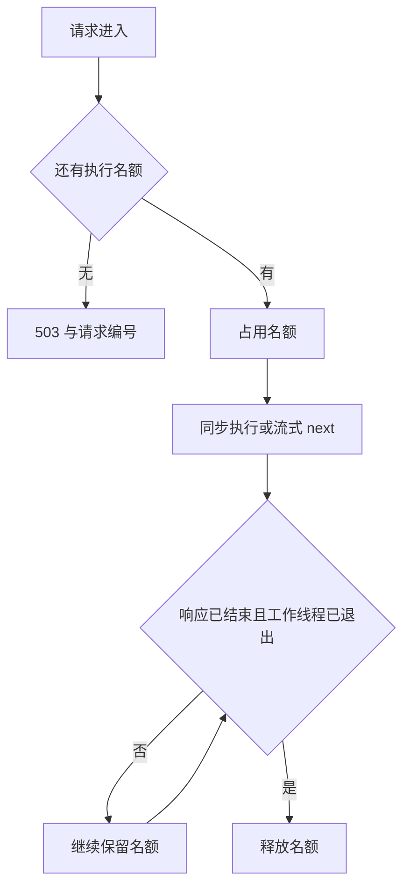

# 并发准入与过载恢复

FinReceipts 对开销较大的 HTTP 操作设置每进程执行名额，在进入执行线程、读取请求体和
占用持久化调度预算之前进行检查。容量已满时立即返回 503，保留查询与取消入口。
名额覆盖响应生命周期，也跟踪尚未退出的同步工作线程，避免客户端断开后过早接纳新工作。

## 已复现的问题

本轮基线为 `29ac5e0`。阻塞第一个模型调用后，旧实现仍接收第二个问答，
并允许推进另一项持久化任务；两个新增测试预期 503，实际均为 200。
请求持续增加时，这些工作会进入线程池等待或继续发起外部调用，应用没有明确的过载边界。

新实现位于 [admission.py](../src/finreceipts/app/admission.py)。
它限制当前 HTTP 执行数量，不改变 Agent 状态路由，也不在后台自动重试失败请求。

## 配置与接口范围

`FINRECEIPTS_MAX_INFLIGHT` 默认 **4**，允许整数 **1 到 32**；非法配置在启动时拒绝。
Docker Compose 已转发该配置。4 是本地开发的保守默认值，不代表实测最优生产容量。

| 受准入限制的操作 | 满载前的检查位置 |
|---|---|
| POST `/api/ask` | 模型执行之前 |
| POST / GET `/api/ask/stream` | 响应头和流式节点执行之前 |
| POST `/api/audit` | 证据读取和核验之前 |
| POST `/api/runs` | 读取事实与创建任务之前 |
| POST `/api/runs/{run_id}/advance` | 领取任务、修改 revision、预留预算之前 |
| GET `/api/runs/{run_id}/counter-audit` | 双条件复核之前 |

任务查询、事件补读、导出、取消、显式恢复和健康查询不占用执行名额。
这些入口仍使用本来的版本检查与租约约束；允许取消不代表能撤回已经发给供应商的请求。
在工作台推进请求尚未返回时，可刷新页面或重新打开任务链接，再查看状态和取消。

过载响应包含 `code=capacity_exhausted`、`Retry-After: 1` 和服务端请求编号。
SSE 过载在发送流之前返回 HTTP 503，不用已经发送的 HTTP 200 表示准入失败。
用户应稍后刷新任务状态再试，持久化推进仍需当前 revision。
重复创建请求被拒绝后可沿用原幂等键；本次拒绝不会创建任务或读取新证据。

## 请求结束与工作结束



同步模型调用不会因为调用方不再等待就自动停止。
每个准入许可记录请求是否结束、实际工作线程数和是否已经释放。
取消 HTTP 任务时，若线程仍在执行，名额保留；最后一个线程退出后释放一次。
请求关闭后，新的工作不能再使用该许可。

流式迭代器只在真正执行阻塞 `next()` 时登记工作线程，响应尚未结束时仍保留准入许可。
它不会预取、缓冲整个回答，也不会因为暂停发送某一块而额外发起模型调用。

需要区分两种结束：

- **仅断开连接**：持久化节点可以完成并提交，预算仍计一次，之后通过 GET 查询结果。
- **明确取消任务**：取消接口撤销 worker token，晚到结果不能提交；线程退出前仍占名额。

## 状态与诊断

`GET /health` 新增 `execution` 对象：

| 字段 | 含义 |
|---|---|
| `limit` | 当前进程配置的最大执行数 |
| `active` | 仍持有名额的请求或未退出工作 |
| `peak_active` | 当前进程自启动以来的峰值 |
| `admitted` | 累计接纳次数，包括随后验证失败的请求 |
| `rejected` | 累计容量拒绝次数 |

这些是进程内计数，重启后归零，不是持久化账单指标。
健康检查在满载时仍返回 200；调用者通过 `execution` 判断繁忙程度，不把容量满误判成进程死亡。
拒绝日志保留固定路由模板、`capacity_exhausted` 和请求编号，不记录请求正文。

## 实际验证

[23 个测试用例](../tests/test_admission.py) 覆盖所有受保护入口、HTTP 任务取消、SSE 取消、
持久化任务取消与断连、许可重复关闭、关闭后迟到工作、root_path 前缀、配置边界、
输入验证失败后的回收，以及拒绝时不读取请求体。
拒绝推进时直接比较完整导出，证明 revision、事件与预算不变；阻塞模型的调用数仍为 1。

[负载脚本](../scripts/admission_load.py) 启动隔离的回环服务，使用实际 HTTP 和延迟 250 ms 的 FakeLLM。
每组先预热一次，再同时提交 32 个请求；8 个健康查询与该突发重叠。
P95 使用排序后的最近秩，成功与拒绝分别统计，不将快速拒绝混进成功请求延迟。

2026-10-18，Windows / CPython 3.12.11，以下为 `combined` 本地记录：

| 每进程容量 | 接纳 / 拒绝 | 模型并发峰值 | 成功请求 P95 | 拒绝请求 P95 | 健康查询 P95 |
|---:|---:|---:|---:|---:|---:|
| 1 | 1 / 31 | 1 | 259.51 ms | 49.23 ms | 24.50 ms |
| 4 | 4 / 28 | 4 | 268.02 ms | 41.28 ms | 22.51 ms |

每组结束后 `active=0`，随后新请求成功。这里的延迟包含本机客户端、HTTP 与 fake 模型等待，
不是供应商响应速度、生产吞吐量或可用性承诺。

额外真实连接实验在模型线程受控阻塞时关闭 SSE 客户端连接，
确认名额仍为 1、新工作返回 503，释放模型后名额归零并恢复接纳。
真实 Edge 验收则在工作台推进期间刷新、取消任务，并在快速问答页触发过载提示。
取消后预算保留为 1，晚到回答未发布，手机布局无横向溢出，pageerror 为零。

## 复现

本轮新增 23 个展开后的用例。最终全量离线回归为 **714 passed / 1 skipped，36.03 秒**，
跳过的是既有 Windows symlink 权限用例，不计作通过。Ruff 静态/格式检查、JavaScript 语法和
Git 差异格式检查均通过；本轮没有运行远端 CI 或真实模型评测。

本地原始证据位于 `runs/admission-20261018/`：`full-final.xml` 为全量结果，
`combined/summary.json` 为突发与断连实验，`combined/capacity-1/browser-ui/` 为浏览器截图与记录。
`evidence.json` 绑定源码、测试及实验结果的 SHA-256。忽略目录不随仓库分发，以下命令用于外部复核。

```powershell
.venv\Scripts\python.exe -m pytest tests/test_admission.py -q
.venv\Scripts\python.exe scripts/admission_load.py --out runs/my-new-admission-check
# 已提供 Node、Playwright 与 Edge 时，一并复现受控浏览器场景：
.venv\Scripts\python.exe scripts/admission_load.py --out runs/my-new-admission-browser --browser
```

脚本只启动本机 fake 服务，使用新的数据库与输出目录，拒绝覆盖已有记录；结束后关闭所启动的进程。
默认测试容量 1 和 4，支持 `--capacity`、`--requests`、`--delay-ms`。
如果实际没有发生过载，脚本失败并要求调整实验条件，不输出虚假的容量验证通过。
浏览器模式需要容量列表包含 1；Playwright 可通过调用方的 `NODE_PATH` 提供，不加入应用运行依赖。

## 适用边界与技术讲述

这是单进程 HTTP 准入，不是全局限流、租户配额或分布式任务队列。
多 worker / 多副本各自计数；绕过 HTTP 直接调用 RunService 不受此门槛约束。
它不限制每分钟请求数、不保证公平排队，也不设置请求体大小或完整请求时限。
已接纳的慢请求或慢客户端可能长期占用名额，仍需要供应商超时及部署层时限配置。

适合技术讨论的核心取舍是：**为什么不能只在 HTTP finally 中释放信号量？**
因为工作线程可能还在调用供应商。可以展示断连时 `active=1`、新请求被拒绝、
线程退出后才恢复接纳这一组证据，再说明本地计数在多副本下为什么不够。
当前线性工作流的模型并发峰值已在受控实验中测量，不能据此宣称任意自定义并行 Agent 都有相同上限。

参考：[Starlette 线程池](https://www.starlette.io/threadpool/)、
[AnyIO 工作线程与取消](https://anyio.readthedocs.io/en/stable/threads.html)。
