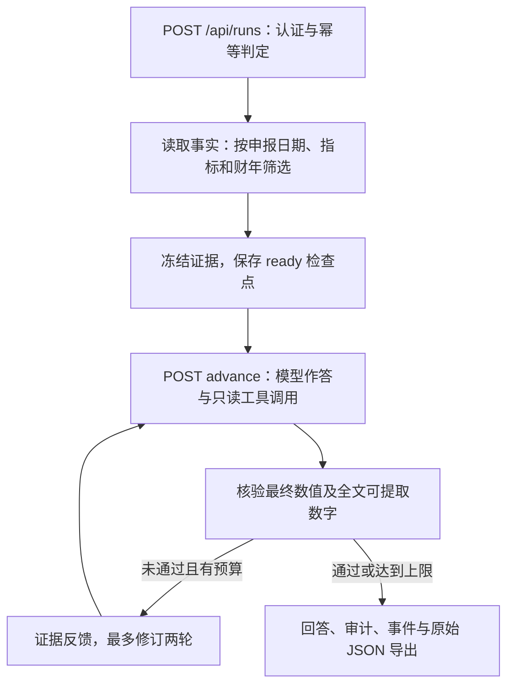

# FinReceipts：一条 Agent 与 AI 后端实战主线

从一个问题开始：**苹果 AAPL 2023 财年的营业收入是多少？**
保留的 SEC 事实给出 383,285,000,000 USD。困难不止是让模型写出金额：
金额可能属于另一个指标或年度，证据可能尚未申报，浏览器也可能在任务提交后丢失响应。
本实践围绕这条链路，分别解释证据契约、确定性核验和幂等创建。

## 先画步骤，再找代码



| 步骤 | 读源码时实际进入的位置 | 断点应观察的内容 |
| --- | --- | --- |
| 身份 | `app/auth.py:Authentication.__call__` | `principal_id` 来自服务端 token 摘要映射 |
| 创建入口 | `app/runs.py:run_router.create_run` | `CreateRun`、`Idempotency-Key`、服务端模型设置 |
| 去重与冻结 | `runtime/service.py:RunService.create` | 先 `store.find`，命中时不再取证；未命中时固定 FactLookup |
| 事实选择 | `evals/runner.py:edgar_lookup_provider`、`xbrl/facts.py:annual_series` | 财务期间与申报日期分别处理；默认选择原始申报值 |
| 模型与工具 | `agent/graph.py:_answer_node`、`_run_tool`、`agent/tools.py:run_get_fact` | 工具名称、参数、工具 JSON 和模型原文 |
| 绑定核验 | `verify/target.py:verify_target_answer` | 最终数字只与目标计算比较，不到其他指标里寻找巧合 |
| 控制流 | `agent/graph.py:_verify_node`、`verification_passed`、`feedback_message` | 两类核验都通过才结束成功分支；每轮保存当前审计 |
| 原子提交 | `runtime/store.py:_save`、`finish` | 检查点与事件在同一事务内提交；revision 和 lease 拒绝旧结果 |
| 导出 | `app/runs.py:export`、`runtime/store.py:verify_export` | 请求、冻结证据、每轮回答、预算及事件链 |

源码位于 [`src/finreceipts`](../src/finreceipts/)。持久化只有两张表：

| 表 | 字段与职责 |
| --- | --- |
| `runs` | `run_id`、唯一 `request_key`、`owner_id`、`operation`；`document` 保存请求、冻结事实、检查点、预算、scope 和质量状态 |
| `events` | 主键 `(run_id, seq)`；`document` 保存时间、事件、状态摘要和前序哈希 |

财务事实不是另一张 SQL 表；每个任务把选中的 FactLookup 固定到 `runs.document.evidence`。
模型工具和核验器使用同一份冻结事实，因此恢复任务不会悄悄换一批数据。

## 数据与证据契约

创建请求可以声明一个明确目标，例如：

```json
{
  "question": "苹果（AAPL）2023 财年的营业收入是多少？",
  "ticker": "AAPL",
  "fiscal_years": [2023],
  "as_of": "2024-01-01",
  "target": {"kind": "direct", "metric": "revenue", "fiscal_year": 2023},
  "use_tools": true,
  "max_revisions": 2
}
```

`kind` 支持 `direct`、`ratio`、`yoy_growth`；比例必须给出指标名称 `denominator`。
指标使用现有白名单。单位与预期值从服务端事实及计算产生，请求不能夹带答案键。
目标模式只接受一个财年，修订上限为两轮，不使用模型升级；同比需要的上一年自动固定。
没有 `target` 的请求继续使用历史数值匹配流程。

`Fact` 记录 CIK、主体、XBRL concept、金额、单位、起止期间、申报编号、申报日期和出处链接。
派生 `Evidence` 另外保存参与计算的事实、公式、预期值及单位。
`TargetAudit` 的声明可以为空，但结论和失败原因始终明确。

| 情况 | 处理 |
| --- | --- |
| 空回答、无最终 `ANSWER:` 行、无数字、多个最终数字 | `unsupported`，分别保留原因；不能因提取为空而通过 |
| 金额为零 | 正常核验；零不等于缺值 |
| 百万、十亿、万、亿等数量级 | 转换到基础单位，保存表面数字及舍入步长 |
| 缺单位、冲突标记、USD/CNY 错配 | 拒绝支持；数量级换算不包含货币兑换 |
| 缺事实、缺同比前期 | `missing_evidence`；创建阶段拒绝且不调用模型 |
| 比例或同比的分母为零 | `zero_denominator`，不产生一个伪造的零增长率 |
| 数字超出有限范围或分析上限 | 沿用 `NumericInputError`，运行可进入不可恢复的 `failed` |
| 工具受控超时 | 工具 JSON 带 `tool_timeout`；调用尝试仍留痕，不编造事实值 |

金额默认相对容差为 0.5%，百分比默认绝对容差为 0.05 个百分点；
与表面数字允许的舍入误差取较大者。核验通过应理解为**在配置容差内获得支持**。

时间需要说清三个概念：财年由事实的期间确定；`as_of` 按 `filed <= as_of` 过滤申报日期；
快照获取时间是另一条证据。当前保留快照的原始获取时间未知，因此不声称实现独立认证的历史可用性证明。
工作台显示 `snapshot_retrieved_at: null`，不会拿冻结时间代替原始获取时间。

目标由结构化输入指定；此功能没有实现任意自然语言问题理解。
最终目标数值通过不代表正文全部正确。正文继续使用现有、有语法范围限制的年度语句复核，
导出始终保留 `whole_answer_verified: false`。

## 亲手实现一个函数

练习入口是 [`verify_target_answer`](../src/finreceipts/verify/target.py)，而不是再写一个模型 Critic。
先遮住参考函数，保留下面的签名和边界要求：

```python
def verify_target_answer(answer, target, lookup, tol=None):
    # 1. 只计算目标指标及财年的证据，处理缺失和零分母。
    # 2. 检查整个回答的分析上限，再解析最后一行 ANSWER:。
    # 3. 最终行必须恰有一个明确单位的数值。
    # 4. 复用 extract_numbers、compute 与 check_value。
    # 5. 返回声明、结论、原因代码和完整证据，不调用模型。
    ...
```

用 `tests/test_target.py` 中的真实事实与负例验收。应能解释两个关键反例：
净利润金额确实存在于同一份事实集，但不能用于证明营业收入；上一年的金额也不能证明本年数值。
练习完成后对照参考实现，并能说明空声明为何需要独立表达、如何避免把缺失当作零。
亲手完成练习与阅读 AI 辅助实现是不同的完成状态，不预先把后者写成个人独立实现经历。

## 可靠性只深入幂等创建

幂等指同一业务操作重复请求，不产生重复业务效果。这里的一次业务效果是创建一个持久化任务，
不是保证外部模型恰好执行一次。

浏览器在一次新操作时生成 UUID，先保存恢复记录并回读确认，再发出 POST。
服务端计算：

```text
storage_key = "v2:" + SHA256(canonical([principal_id, "create_run", original_key]))
```

规范化后的请求摘要另外绑定问题、期间、模型设置、目标和实现标识。
同一用户与操作下，同键同请求返回原任务；同键异请求返回 409。
不同用户使用同一原始键允许各自创建任务。重新发起一项新研究应生成新键，不对相似问题做语义去重。

`BEGIN IMMEDIATE` 与唯一约束处理两个请求同时错过前置查询的竞争：
事务内再次检查键，只有一条任务和一个创建事件落库。创建本身不调用模型。
推进则使用现有 revision CAS 与 lease；旧 revision 不能重复提交一个步骤。

页面刷新后的恢复还需要同一用户、原键、原正文。身份不匹配时保留记录并阻止重发，
旧版无身份记录只允许在 `local` 用户下恢复。Token 不进入恢复记录、URL 或浏览器存储。
未知外部调用仍可能在显式恢复后重复；预算预留会保留，不能声称模型侧 exactly-once。

认证配置、私有读取和迁移步骤见 [认证与作用域](AUTH_AND_IDEMPOTENCY.md)。

## 五分钟演示

1. 用新的输出目录启动离线服务：设置 `FINRECEIPTS_OFFLINE=1`、`FINRECEIPTS_LLM_PROVIDER=fake`、
   `FINRECEIPTS_CACHE_DIR=tests/fixtures/sec`，把 `FINRECEIPTS_RUN_DB` 指到新位置。
2. 打开工作台，勾选绑定目标，选择营业收入、2023、截止 2024-01-01。创建后展示零模型调度及冻结证据摘要。
3. 推进任务，展示刻意错误的回答、目标审计、证据反馈和修订后结果；说明 FakeLLM 演示不代表真实模型能力。
4. 展示创建响应丢失后的浏览器验收记录：服务端重启、页面刷新、重新认证后确认原请求，仍只有一个任务。
5. 切换第二个用户，展示其列表及拒绝访问他人导出的 404；切回原身份下载原始 JSON，运行导出检查器。

财务工具调用的完整执行轨迹可在离线契约验收的 `trace.jsonl` 中查看；
普通工作台 FakeLLM 固定回答不保证主动请求工具，不能把工具开关当作实际工具调用证明。

## 面试追问

- **为什么是 Agent 应用？** 共享状态组织作答、只读工具、确定性核验和有限修订，审计结果控制下一步。
- **为什么不只做 RAG？** 出处存在不能证明金额属于正确指标或期间；这里直接计算结构化目标的预期数值。
- **为什么还保留旧匹配？** 旧实验语义和结果需要可复算；新目标模式是新增契约，没有重写历史成绩。
- **为什么 token 不直接成为幂等键的一部分？** 用户标识稳定，token 可以轮换；换凭证不应另建同一任务。
- **数据库事务能保证模型不重复收费吗？** 不能。外部调用和 SQLite 提交不在同一个事务里，未知结果需要明确恢复。
- **SHA-256 能证明事实真实吗？** 只能绑定内容变化；没有独立来源认证或可信时间戳，就不能据此证明真实性和历史公开时间。
- **评测数字如何使用？** 先说明样本、策略、分母及来源，再展示失败。固定响应验收不能写成真实模型准确率。

评测准备、开发/冻结集、三组策略与报告口径见 [评测说明](AGENT_BACKEND_EVALUATION.md)。
