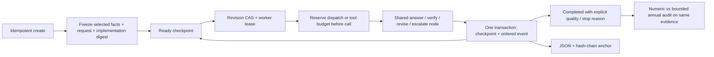

# Durable evidence runs

This local runtime adds durable execution **at existing agent node boundaries**.
The original `/api/ask` and `/api/ask/stream` remain request-scoped and preserve
their numeric-only evaluation semantics. The new `/api/runs` family is explicit
about recovery, scope and budgets.

## Start an offline demo

From a source checkout on Windows PowerShell:

```powershell
uv sync --locked --extra dev --extra web
$env:FINRECEIPTS_OFFLINE='1'
$env:FINRECEIPTS_LLM_PROVIDER='fake'
$env:FINRECEIPTS_CACHE_DIR='tests/fixtures/sec'
$env:FINRECEIPTS_RUN_DB='.cache/runs.sqlite3'
uv run finreceipts-api
# Open http://127.0.0.1:8000/workbench
```

No model key is needed. The fake responder is scripted, including an initial
wrong Apple figure followed by a correction. This is a workflow demo, not an
accuracy evaluation. Real providers still require the existing explicit
[configuration](llm_access.md). Models for durable runs come from server config.

## Execution and storage



The SQLite runner deliberately reuses `agent.graph.step_nodes` and `next_node`.
It is **not a LangGraph checkpointer implementation** and does not claim arbitrary
LangGraph task scheduling. A parity test checks both execution paths. The small
runner lets this project commit the application checkpoint and the client-facing
event together, with explicit reservations. Adopting an official persistent
LangGraph saver plus a transactional outbox is a sensible production evolution.

`BEGIN IMMEDIATE` serializes mutations. Every mutation checks the stored state
and event chain, increments a revision, and appends one event. Every model
dispatch and tool attempt reserves a persisted counter. The counters include
unknown outcomes. Reported token usage covers committed successful node output;
it can undercount interrupted requests. SDK retries may issue multiple HTTP
requests per logical dispatch. These are not monetary limits.

SQLite write contention waits up to one second per connection operation by default
(`RunStore(..., busy_timeout=...)` can override it). `SQLITE_BUSY`, including its
extended codes, becomes `StoreBusy`; the run API returns 503 with `Retry-After: 1`.
Disk, corruption and SQL errors are not classified as contention. This timeout is
not an end-to-end request deadline. The runner never retries a whole node on a
storage error. A model call may already have happened before a failed commit:
refresh with GET first, then use the current revision if ready, or explicitly
resume interrupted/expired work. Active leases must expire before recovery.

A random token fences each worker. Cancelling or recovering an expired lease
revokes the old token. An expired worker cannot reserve more budget or commit a
result. The default lease is 300 seconds. Calls longer than the lease cannot
commit; there is no heartbeat renewal in this local runner. A network request
already sent to a provider cannot be undone.

## Crash / recovery contract

| Failure window | Durable state | Recovery |
|---|---|---|
| Before claiming a node | Previous committed checkpoint | Advance normally |
| After claiming, before dispatch | Active lease, no new reservation | After lease expiry, explicitly resume |
| After reservation, before result commit | Reservation retained; last completed node unchanged | Explicit resume may repeat an uncommitted call |
| After checkpoint commit, before HTTP response arrives | New revision and event exist together | GET state; retry with stale revision returns 409 |
| Cancellation while provider is responding | Terminal cancellation; worker token revoked | Late output cannot publish; bill may still exist |
| SQLite busy before claim | Previous checkpoint, no model dispatch | Refresh and retry after contention clears |
| SQLite busy after model response | Running lease and reservation; answer not committed | Refresh; explicitly resume after expiry; reservation is retained |
| Source or provider changes | Original run stays readable | Advancing fails; export and start a new run |

There is no exactly-once guarantee for external providers. Creation is idempotent
for an identical normalized request and key; it does not solve provider-side
idempotency. Resuming requires an acknowledgement of possible duplicate calls.
The workbench saves an unresolved creation key and its input in tab-scoped session storage
before sending. After a lost response and reload, explicit confirmation reuses that request;
the run URL is saved before the record is cleared. See [creation recovery and tests](CREATE_RECOVERY.md)
for storage failures, process-restart evidence and the same-tab limitation.
The checkpoint is one **whole answer node**, which may contain several tool/model
exchanges, so an interrupted answer node may repeat those uncommitted exchanges.

## API

| Method / path | Contract |
|---|---|
| POST `/api/runs` | `Idempotency-Key` header, validated request, fixed evidence, no LLM call |
| GET `/api/runs` | Read-only metadata; limit 1..50, opaque cursor, no model calls; [pagination contract](RUN_HISTORY.md) |
| GET `/api/runs/{id}` | Current persisted state; never advances work |
| POST `/api/runs/{id}/advance` | `{ "expected_revision": 1 }`; executes one node |
| POST `/api/runs/{id}/cancel` | Expected revision; revokes lease |
| POST `/api/runs/{id}/resume` | Expected revision + `acknowledge_possible_duplicate: true`; no model call yet |
| GET `/api/runs/{id}/events` | Finite SSE catch-up; `Last-Event-ID` or `after` cursor |
| GET `/api/runs/{id}/export` | State, request, evidence, full ordered event chain |
| GET `/api/runs/{id}/counter-audit` | Same evidence and answer, two verifier modes, zero model calls |

Save export responses as their original HTTP bytes. The current hash codec normalizes parsed
values with Python JSON rules; reserializing through another runtime can change `0.0` to `0`
and invalidate the chain. It is not an RFC 8785 cross-language encoding contract. The browser
smoke script now preserves response bytes and verifies the saved file, not only the in-memory object.

The event endpoint is a finite snapshot stream. Poll/reconnect from the last
sequence after an advance. It does not keep a connection alive with heartbeats,
start a worker or emit token-level streams. Invalid cursors return 422; a cursor
ahead of the current revision returns 409. The UI saves the run ID in its URL.

No authentication or tenant isolation is provided. Bind locally, keep the run
database private, and do not put real credentials into questions or tool results:
those messages are part of the requested export. Arbitrary provider exception
text is not persisted by the durable runner. Model-produced content itself is
not a secret-redaction system. Runtime files are excluded by `.gitignore`.

## Evidence and integrity

The frozen evidence is a canonical JSON **selected FactLookup**, limited to
requested years plus preceding years for growth calculations. It is not the raw
SEC response or a trusted timestamp record. Existing SEC snapshot/PIT controls
have a different role; see [sec-snapshots.md](sec-snapshots.md).

`workflow_version` guards the storage contract. The request also binds Python
source hashes and core runtime/serialization dependency versions. This is a
compatibility guard, not a full container/environment attestation.

The event chain binds each ordered event to its predecessor and the committed
state digest. Store reads verify the chain and current evidence/request digests.
A database administrator could rewrite the entire chain; the separately saved
final hash detects that only if the saved hash is itself trusted. There is no
digital signature, trusted timestamp or guarantee that the source facts are true.

```powershell
uv run python scripts/runtime_demo.py --out runs/my-new-diagnostic
uv run python scripts/verify_run_export.py runs/my-new-diagnostic/scoped_correct.json
# Add --anchor <separately saved final event hash> for anchor comparison.
```

The demo refuses to overwrite an output directory. It uses six handwritten
cases, not an independent evaluation set. Four expose numeric/semantic mismatch;
the normal annual clause passes both conditions; a numberless answer passes
neither. Counter-audit abstention can mean unsupported grammar, not a false
financial assertion. Neither condition proves whole-answer correctness.

## Verification

```powershell
uv run pytest tests/test_runtime.py tests/test_run_api.py -q
uv run pytest -m 'not live' -q
uv run ruff check .
uv run ruff format --check .
```

An optional real-browser script is `scripts/browser_runtime_smoke.cjs`. It uses
Playwright from the caller's Node environment, defaults to installed Edge, and
expects an offline fake-model server at `127.0.0.1:8791`. Pass a new output folder.
Browser automation is intentionally not a runtime dependency. The script asserts
reload without recalling the model, revision completion, counter-audit, exports,
event catch-up, mobile width, and cancellation before dispatch.

For file publication faults, four-process races, actual process termination and
storage-error recovery, see [reliability scenarios](RELIABILITY.md).
HTTP errors now include a stable `code` and server-generated `request_id`, also
returned as `X-Request-ID`. See [request diagnostics](REQUEST_DIAGNOSTICS.md) for
safe logging, streaming failure semantics and the troubleshooting workflow.

The HTTP server now applies process-local admission before creating/advancing
runs and other expensive operations. `FINRECEIPTS_MAX_INFLIGHT` defaults to 4;
overload returns 503 `capacity_exhausted` with `Retry-After: 1`, without changing
the run or reserving budget. Reads and cancellation remain available. A client
disconnect cannot free a slot while its synchronous worker is still running.
This is not a cross-worker quota or a limit on direct RunService callers.
See [admission controls and measured scenarios](ADMISSION_CONTROL.md).

For online SQLite backups, semantic verification, and restoration to a new directory,
see the [backup and restore runbook](BACKUP_RESTORE.md). Restoring preserves reservations,
leases and implementation checks; it never automatically replays an external call.

The HTTP service now checks exact allowed hosts and browser-origin headers before execution.
See [browser access boundary](BROWSER_BOUNDARY.md) for configuration, real browser evidence,
and why these controls do not provide authentication or tenant isolation.

Compose stores runtime SQLite files in a separate named volume. Existing containers with
writable-layer databases require migration before recreation; see [container storage](CONTAINER_STORAGE.md)
for the runbook and the distinction between configuration validation and actual Docker evidence.
