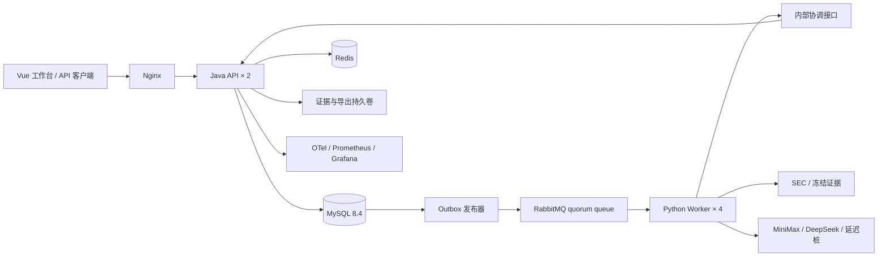

# FinReceipts 2.0：业务与执行边界

研究员提交年度财报核验批次；Java 冻结配置并接纳任务，Python 准备证据与执行计算或模型工具循环，复核员审核具体结果版本，交付包只包含已接受的版本。机器结论、执行状态、人工决定独立保存。

## 一条主链路

1. `POST /api/v2/batches` 验证会话或 Token，从成员记录得到租户。事务锁定该租户的配额行，检查相同用户的幂等键及正文摘要，写入批次、任务、初始事件和 Outbox。最多 100 项，返回 202。
2. 调度器按租户 `last_dispatch` 轮转，使用 `FOR UPDATE SKIP LOCKED` 与租户并发上限选择待执行任务。任务从 QUEUED 进入 READY，递增 revision，更新 Outbox 对应版本并记录事件。排队任务不预占模型名额。
3. 发布器用短事务领取 Outbox 的 10 秒发布租约，事务结束后等待 RabbitMQ publisher confirm。确认成功才标记 published。确认丢失可能导致重复投递；消息包含任务 revision，过时投递不能领取任务。
4. Worker 领取一步执行租约。Java 将任务改为 RUNNING，返回新的 revision、随机 fencing token、冻结配置和检查点。Worker 每 10 秒续租，默认租期 45 秒。
5. PREPARE 从 SEC Company Facts 提取目标指标与相邻年度，保存来源、日期、单位、金额和摘要。明确指标直接计算；缺证据给出 UNSUPPORTED；研究表述才进入 MODEL。
6. 每次模型 HTTP 尝试先 reserve，得到确定响应后 settle。完整 provider-native thinking/tool 内容块进入检查点，工具名称、公司、年度、指标、参数和调用次数均受限制。VERIFY 核验最终数字；最多两轮修订，最多六次模型尝试。
7. commit 同时检查 lease token、revision 与未结算尝试，保存检查点、证据、结果和事件。提交成功后 Worker 才 ACK。commit 响应丢失时，同一租约的同正文重复提交只返回原结果；不同正文冲突。
8. 复核员查看证据并接受或驳回，不能审核自己的任务。人工接受不改变 SUPPORTED/UNSUPPORTED 机器结论。导出读取已接受版本，并将内容按 SHA-256 镜像到持久卷。

## 故障和计费语义

| 边界 | 持久结果与恢复行为 |
|---|---|
| 任务事务成功，消息尚未发布 | Outbox 留在数据库；发布器恢复后重发 |
| 消息成功，publisher confirm 丢失 | 发布租约到期可重发；revision/领取状态阻止重复执行 |
| 未预留外部调用的 Worker 退出 | 租约到期重新排队，revision 递增 |
| 已预留调用，Worker 退出或结果不明 | UNKNOWN，保留预算占用；需要显式确认才能重试 |
| commit 已成功但 MQ ACK 丢失 | 重投无法再次领取过时版本 |
| 取消与迟到结果竞争 | 旧 lease token/revision 不能覆盖取消状态；计费结算仍可记录 |
| Redis 不可用 | 新接纳/派发失败关闭；MySQL 仍保存任务与预算 |
| 证据卷暂时不可写 | SQL 内 artifact_copies 保留原文与哈希；复制器重试，SQL 为权威副本 |

这不是外部模型调用的 exactly-once 保证。reserve 与真正发送 HTTP 之间也可能崩溃，因此 UNKNOWN 的预算保留是保守策略。人工确认重试不退还未知尝试的占用；供应商账单核对与费用调整应另留审计记录，首版不自动推断退款。

金额使用人民币微元整数。首版保守估算率为每百万输入/输出 token 3/12 元；每次按 32,000 输入字节上界和 4,096 输出 token 预留。实际模型账单可能不同。业务台账与独立评测台账各设 10 元上限，合计不超过本期 20 元授权。

## 并发保护与可观测性

API 限流、租户待执行数、租户 READY/RUNNING 数、全局模型并发、尝试数和金额预算分别控制。Redis 管理共享会话、速率窗口和 SSE 连接租约；MySQL 管理不可重置的账本、任务与事件。每 API 的 Hikari 池上限为 12，事务采用 READ COMMITTED。查询只读摘要列，租户复合索引与 ID 游标避免 OFFSET 和逐条加载事件。

SSE 每租户最多 600 连接，30 秒连接轮换，支持 `Last-Event-ID`。事件读取不会启动执行。每次轮询重新验证成员关系；慢客户端受发送/连接超时约束。源码通过 OTel traceparent 将 HTTP 接纳、任务事件、MQ 消息与 Worker 内部请求关联；模型尝试另有 task_id、lease_token、attempt_id 和 usage。SQL 指标缓存 5 秒，提供排队、运行、UNKNOWN、预算和最老等待时间。

SEC 抓取使用 Redis 全 Worker 共享速率控制及来源键互斥，成功结果写共享缓存；任务冻结后不随缓存更新改变。缓存、会话和事件订阅均不是业务状态权威。

## 对热点工程经验的具体采用

| 参考 | 采用的位置 | 本期边界 |
|---|---|---|
| [Pi extensions](https://pi.dev/docs/latest/extensions) | `platform/models.py`、`platform/engine.py` 的适配器、允许工具和核验策略 | 代码注册；无任意脚本或插件市场 |
| [Pi compaction](https://pi.dev/docs/latest/compaction) | 完整消息检查点与裁剪后的指标证据分离；原生工具调用配对保留 | 不用摘要改写财务金额/单位/来源 |
| [DeepSeek Harness architecture](https://github.com/deepseek-ai/deepseek-harness/blob/master/docs/architecture.md) | 内容哈希配置版本、实现指纹、持久状态事件、可替换模型与数据适配 | 不跨实现指纹恢复旧模型上下文 |
| [OpenCode server](https://opencode.ai/docs/server/) | OpenAPI、多客户端、工具前权限与预算决策、持久复核记录 | 服务端只暴露财务业务能力 |
| [RabbitMQ reliability](https://www.rabbitmq.com/docs/reliability) | publisher confirms + durable quorum queue + consumer ACK + 业务去重 | 接受重复投递，不能依靠 MQ 声称外部调用恰好一次 |

旧 Python CLI、`/api` 和 SQLite 数据不迁移覆盖。`v2_import_archive.py` 先验证旧事件链，再将原始导出字节上传只读归档；归档不能作为新版检查点恢复。

## 部署边界

Compose 是单机两个 API、四个 Worker 与真实中间件。Redis、MySQL、RabbitMQ 仍为单实例；本机多副本演练不等于跨机器高可用。默认 fake 模型与离线 SEC 夹具用于演示和容量测试，真实评测使用独立数据版本与预算日志。

本机 Docker 磁盘经用户确认于 2026-10-24 迁移至 `D:\FinReceipts\.cache\docker-data\DockerDesktopWSL`。该目录包含数据库与持久卷，**不得作为普通缓存清理**。应使用 Docker 设置迁移，不能删除 VHDX 或 factory reset。
