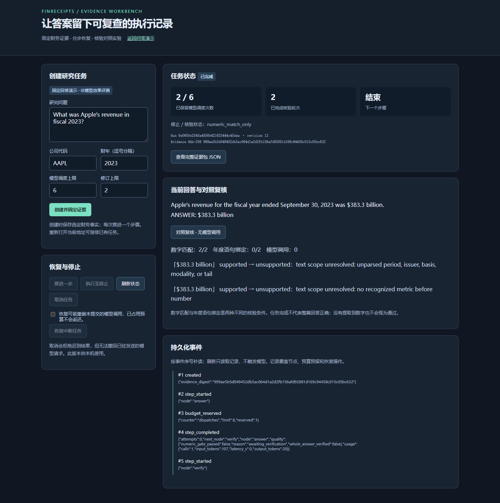

# 本轮验收记录

本文件保留 2026-10-13 至 14 的原始验收。2026-10-18 的故障、容量、浏览器和恢复结果
统一索引于[验证索引](VERIFICATION_INDEX.md)与[工程案例](ENGINEERING_CASES.md)，
不以新测试数量覆盖下文的历史记录。

验收日期：2026-10-13 至 14（Asia/Shanghai）。
基线：未合并 PR #1 的 `165aba5adb382f504f8c11d96a935dcd3da8bcb5`。
改进分支：`codex/evidence-runtime`。

## 环境与结果

- Windows，隔离 `.venv`，CPython **3.12.11**；依赖已写入 `uv.lock`。
- 离线 SEC fixtures、FakeLLM；没有真实模型调用或新账单实验。
- `ruff check .`：通过；`ruff format --check .`：107 个 Python 文件符合格式。
- `uv lock --check`：通过；`uv sync --locked --extra dev --extra web`：通过。
- 最终全量测试：**633 passed / 1 skipped，83.28 秒**。
  命令为 `python -m pytest -m 'not live' -q --junitxml=...`。
- 唯一跳过：当前 Windows 账户无法创建符号链接（WinError 1314）。
  仅跳过该权限错误，Linux CI 继续执行原路径逃逸测试。本轮没有运行远端 Linux CI。
- 原始基线：604 passed / 1 failed，失败为同一符号链接测试的准备环境权限。
  本轮新增 **29 项展开后的测试用例**；不能把 skip 计作 pass。
- Git diff 空白检查：通过。

当前运行时实现摘要（Python 源文件字节及核心依赖版本）：

```text
5fb293c0c253eda6a2006054fc1db56413f361b2e85b0bae61eba3ebc594450e
```

浏览器导出内的实现摘要与上值一致。此摘要不是完整环境或容器证明，Git 提交记录应一并使用。
修改源码、安装依赖或换行转换后，应重新生成记录，不沿用这个结果。

## 真实浏览器验收

使用项目服务器 `127.0.0.1:8791`，本机 Edge 的 headless Chromium 引擎与 Playwright。
这是真实页面交互，不是仅对 HTML 字符串或 TestClient 的检查。

| 验收项 | 实际结果 |
|---|---|
| 创建任务并固定事实 | PASS |
| 推进 answer，刷新后从 verify 继续 | PASS；刷新前后调度次数均为 1 |
| 核验失败后修订至停止 | PASS；演示最终调度次数 2 |
| 双条件对照复核 | PASS；额外模型调用 0 |
| 事件补读 | PASS；本次完整事件 13 条 |
| JSON 证据包导出 | PASS；实现摘要匹配当前版本 |
| 桌面 1440 × 1050 | PASS |
| 手机 390 × 844 | PASS；无横向溢出 |
| 创建后在首次模型调度前取消 | PASS；调度次数 0 |
| JavaScript pageerror | 0 |

原始成功记录：`runs/engineering-20261013/browser-v5/summary.json`。
截图包含固定模型演示内容，未包含凭据或真实用户资料。



## 诊断案例与恢复证据

脚本 `scripts/runtime_demo.py` 使用六个手写输入，固定相同的 Apple 年度事实。
每个案例只调用一次 FakeLLM，重建运行服务后的 verify 不调用模型或数据源。

| 手写案例 | 数字匹配门槛 | 年度语句门槛 | 恢复后的模型调用 |
|---|---|---|---:|
| 正常年度营收语句 | 通过 | 通过 | 0 |
| 正确营收数字写成净利润 | 通过 | 未通过 | 0 |
| 正确营收数字归属另一公司 | 通过 | 未通过 | 0 |
| 正确营收数字归属另一财年 | 通过 | 未通过 | 0 |
| 只有 ANSWER 数字，缺少语义归属 | 通过 | 未通过 | 0 |
| 没有数字 | 未通过 | 未通过 | 0 |

这不是抽样准确率、模型能力对比或真实用户评测。年度语法不支持时会弃权，也会拒绝部分真实但
超出语法范围的表达。不能据此宣称识别所有金融幻觉。

事实集 SHA-256：

```text
999ae5b5d049452db5ac064d1a2d2fb156afd92881d169c94458c015c05bc632
```

`scoped_correct.json` 独立导出校验：PASS。单独传入并比对的最终事件 anchor：

```text
9238c49c9bcd5628e2b6ef34b3e0b1650ee27f1129f7fc2294e1a2868afb4968
```

故障测试还包括真实子进程 `os._exit(17)`：进程在调度预算预留后、结果提交前直接退出。
重建 store 后保留该占用，显式恢复时不能绕过已用尽的预算。其他测试涵盖并发竞争、
迟到结果、事务中途异常、provider / 源码变化、工具越界、哈希链编辑与截断。

## 未由本轮建立的结论

生产可用性、多租户安全、分布式性能、真实模型质量、收费成本、完整历史数据公开时间、
Linux 浏览器体验及远端 CI 状态，均没有由本轮本地测试建立。
本次修改保存在新分支；PR #1 的 OPEN 状态和原 head SHA 在实施前后均应独立核对，
不要将本地验收描述成 GitHub 已发布或已合并。

## 2026-10-14 界面改版验收

本轮针对 UI 的结果为 64 组浏览器布局检查、原生 200% 缩放和 42 项相关后端回归通过，
并重跑原有创建、推进、刷新、补读、修订、导出、复核与取消操作。
详细证据和测试夹具边界见 [UI_REDESIGN.md](UI_REDESIGN.md)。
上方历史全仓验收数量属于此前轮次，不与本轮聚焦回归混用。

## 0.1.0 发布候选复核

2026-10-14 对包含工作台、主题、完整说明和 0.1.0 版本号的候选重新执行全仓离线回归：
633 passed / 1 skipped（Windows 符号链接权限）。锁文件、Ruff、格式检查通过。
独立进程中的原有浏览器流程与 64 组界面验收通过；独立 wheel 安装环境中的页面、静态资源、
创建、推进和导出接口通过。具体范围见 [0.1.0 发布说明](releases/v0.1.0.md)。

## 2026-10-16 工作流表达与真实评测

应用源码仍为 9c7135e 对应实现，新增评测辅助脚本与文档。Windows 全仓离线回归 643 passed / 1 skipped（符号链接权限），Ruff 与格式检查通过。
30 题 × 3 条件真实模型运行完成，保存全部 90 个结果、162 次含探测 HTTP 用量记录，离线复算答案、审计与成本通过。
这些结果与此前固定回答 UI 验收分别记录；本轮没有重跑 64 组界面布局。详见[真实评测报告](WORKFLOW_EVALUATION.md)。
